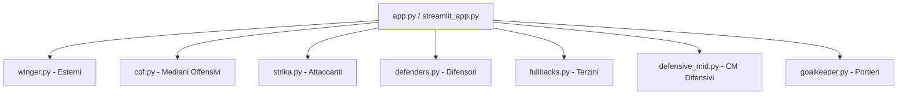

# Analisi Completa Statistiche e Pesi - FM Scout Gem

## 1. ARCHITETTURA DEL SISTEMA

Il sistema analizza i giocatori di Football Manager attraverso **7 moduli specializzati**, ciascuno con pesi statistici specifici per il ruolo:



### Componenti Comuni a Tutti i Moduli

| Funzione | Scopo | Formula/Valori |
|----------|-------|----------------|
| `parse_guide_value()` | Parsing valore guida | €K → ×1000, €M → ×1.000.000 |
| `calculate_age_factor()` | Fattore età | ≤20: 2.0x, 21-23: 1.6x, 24-26: 1.3x, >26: 1.0x |
| `min_max_normalize()` | Normalizzazione | `(val - min) / (max - min)` → [0, 1] |
| `scale_value_index_to_100()` | Scaling punteggio | `(val - min) / (max - min) × 100` |
| `calculate_value_index()` | Indice valore | `(score × age_factor) / price` |

---

## 2. GOALKEEPER (goalkeeper.py)

### Statistiche Utilizzate

#### Shot-Stopping (Peso Alto: 1.5-3.0x)
| Statistica | Peso | Rilevanza per il Ruolo |
|------------|------|------------------------|
| **Save Percentage %** | **3.0x** | Metrica primaria di efficienza parante; indica la capacità di respingere i tiri |
| **Clean Sheets %** | **2.5x** | Capacità di mantenere la porta inviolata; fondamentale per il risultato squadra |
| **Goals Conceded per 90** | **2.0x (invertito)** | Formula: `(10 - goals_conceded_p90) × 2.0` - meno gol subiti = punteggio più alto |
| **Saves per 90** | **1.5x** | Volume di parate; indica impegno e reattività |

#### Distribution/Build-up (Peso Medio: 1.0-1.5x)
| Statistica | Peso | Rilevanza per il Ruolo |
|------------|------|------------------------|
| **Pass Completion %** | **1.5x** | Precisione nei passaggi; essenziale per portieri moderni che costruiscono dal basso |
| **Progressive Passes per 90** | **1.0x** | Capacità di avanzare palla con i passaggi |
| **Distribution Accuracy %** | **1.0x** | Efficienza nella distribuzione del pallone |

#### Claiming/Defensive (Peso Basso: 0.6-1.0x)
| Statistica | Peso | Rilevanza per il Ruolo |
|------------|------|------------------------|
| **Crosses Claimed %** | **0.6x** | Capacità di uscire sui cross; ridotto per bilanciamento |
| **High Claims per 90** | **0.8x** | Uscite alte; importante per dominio area |
| **Sweeper Actions per 90** | **1.0x** | Interventi fuori porta; aumentato per enfatizzare ruolo moderno |

### Formula Score Portiere
```python
goalkeeper_score = (
    save_percentage × 3.0 +
    clean_sheets_pct × 2.5 +
    (10 - goals_conceded_p90) × 2.0 +
    saves_per_90 × 1.5 +
    pass_completion_pct × 1.5 +
    progressive_passes_p90 × 1.0 +
    distribution_accuracy_pct × 1.0 +
    crosses_claimed_pct × 0.6 +
    high_claims_p90 × 0.8 +
    sweeper_actions_p90 × 1.0
)
```

### Impatto sulle Decisioni Operative
- **Valutazione acquisto**: Portieri con Save % > 75% e Clean Sheets > 50% sono优先考虑
- **Rilevanza tattica**: Portieri moderni devono eccellere anche in distribuzione (Pass Completion > 85%)
- **Fattore età**: Premia giovani portieri (<23 anni) con moltiplicatore 1.6x

---

## 3. DEFENDERS (defenders.py)

### Statistiche Utilizzate

#### Metriche Difensive (Peso Alto: 1.5-3.0x)
| Statistica | Peso | Rilevanza per il Ruolo |
|------------|------|------------------------|
| **Defensive Actions per 90** | **3.0x** | Somma di tackle, intercetti, clearances; metrica difensiva primaria |
| **Tackles per 90** | **2.5x** | Azione difensiva per eccellenza; capacità di recuperare possesso |
| **Interceptions per 90** | **2.5x** | Leggibilità tattica e anticipazione; fondamentale per DM/CD |
| **Possession Won per 90** | **2.0x** | Recupero possesso; indica efficacia nel pressing e duel |
| **Clearances per 90** | **1.5x** | Allontanamento palla; utile ma secondario ai tackle |
| **Blocks per 90** | **1.5x** | Blocchi tiri avversari; azione difensiva importante |
| **Pressures Attempted per 90** | **1.5x** | Intensità pressing; aumentato per enfatizzare ruolo moderno |

#### Build-up Play (Peso Medio: 1.0-2.5x)
| Statistica | Peso | Rilevanza per il Ruolo |
|------------|------|------------------------|
| **Progressive Passes per 90** | **2.5x** | Passaggi che avanzano la squadra; cruciale per difensori moderni |
| **Key Passes per 90** | **2.0x** | Passaggi decisivi; importante per costruzione offensiva |
| **Creative Actions per 90** | **2.0x** | Azioni creative totali; utile per difensori che partecipano all'attacco |
| **Pass Completion %** | **1.5x** | Precisione passaggi; base per build-up sicuro |
| **Progressive Pass %** | **1.5x** | Percentuale passaggi progressivi; qualità della costruzione |
| **Passes Completed per 90** | **1.0x** | Volume passaggi completati; statistica di supporto |

#### Altre Metriche (Peso Basso: 0.5-2.0x)
| Statistica | Peso | Rilevanza per il Ruolo |
|------------|------|------------------------|
| **Goal Contributions per 90** | **2.0x** | Gol + assist; sorprendente alto ma utile per difensori offensivi |
| **Average Rating** | **1.5x** | Valutazione generale; proxy di performance complessiva |
| **Header Win %** | **1.5x** | Duello aereo; importante per difensori alti e fisici |
| **Dribbles per 90** | **0.5x** | Dribbling; peso basso perché non primario per difensori |

### Formula Score Difensore
```python
defender_score = (
    defensive_actions_p90 × 3.0 +
    tackles_p90 × 2.5 +
    interceptions_p90 × 2.5 +
    possession_won_p90 × 2.0 +
    clearances_p90 × 1.5 +
    blocks_p90 × 1.5 +
    pressures_attempted_p90 × 1.5 +
    progressive_passes_p90 × 2.5 +
    key_passes_p90 × 2.0 +
    creative_actions_p90 × 2.0 +
    pass_completion_pct × 1.5 +
    progressive_pass_pct × 1.5 +
    passes_completed_p90 × 1.0 +
    goal_contributions_p90 × 2.0 +
    average_rating × 1.5 +
    header_win_pct × 1.5 +
    dribbles_p90 × 0.5
)
```

### Impatto sulle Decisioni Operative
- **Difensori tradizionali**: Priorità a Defensive Actions, Tackles, Interceptions (peso totale ~8.0)
- **Difensori moderni**: Build-up play è cruciale; Progressive Passes e Key Passes hanno peso elevato (~7.0)
- **Fattore età**: Giovani difensori (<23 anni) premiati con 1.6x

---

## 4. FULLBACKS (fullbacks.py)

### Statistiche Utilizzate

#### Metriche Difensive (Peso Totale: ~8.5, 27%)
| Statistica | Peso | Rilevanza per il Ruolo |
|------------|------|------------------------|
| **Defensive Actions per 90** | **2.8x** | Aumentato da 2.5 a 2.8 per enfatizzare azione difensiva |
| **Possession Won per 90** | **2.2x** | Aumentato da 2.0 a 2.2 per valorizzare recupero possesso |
| **Blocks per 90** | **1.8x** | Blocchi tiri; utile ma non primario |
| **Pressures Attempted per 90** | **1.5x** | Pressing; importante per terzini moderni |

#### Metriche Creative/Costruttive (Peso Totale: ~16.3, 51%)
| Statistica | Peso | Rilevanza per il Ruolo |
|------------|------|------------------------|
| **xA per 90** | **2.5x** | Assist attesi; cruciale per creazione occasioni |
| **Key Passes per 90** | **2.5x** | Ridotto da 3.0 a 2.5 per bilanciamento con difesa |
| **Progressive Passes per 90** | **2.0x** | Passaggi progressivi; fondamentale per avanzamento |
| **Progressive Pass %** | **2.5x** | Percentuale passaggi progressivi; qualità costruzione |
| **Open Play Cross Completion %** | **1.8x** | Precisione cross in gioco aperto; ruolo chiave terzino |
| **Clear Cut Chances Created** | **2.0x** | Occasioni da gol create; impatto offensivo diretto |
| **Crosses Completed** | **2.5x** | Cross efficaci; statistica primaria per terzini |

#### Metriche Offensive/Attaccanti (Peso Totale: ~6.5, 20%)
| Statistica | Peso | Rilevanza per il Ruolo |
|------------|------|------------------------|
| **Dribbles per 90** | **1.5x** | Dribbling; utile per terzini che avanzano con palla |
| **Goal Contributions per 90** | **1.5x** | Gol + assist; contributo offensivo occasionale |
| **xG per 90** | **1.0x** | Expected goals; basso perché terzini non sono finalisti |
| **xG Overperformance** | **0.5x** | Rumore statistico; peso minimo |
| **Header Win %** | **2.0x** | Aumentato da 1.5 a 2.0 per enfatizzare gioco aereo |

#### Metrica Negativa (Penalità: -2.0, 6%)
| Statistica | Peso | Rilevanza per il Ruolo |
|------------|------|------------------------|
| **Mistakes Leading to Goals** | **-2.0x** | Errori che portano gol; penalità alta appropriata |

### Formula Score Terzino
```python
fullback_score = (
    # Difesa
    defensive_actions_p90 × 2.8 +
    possession_won_p90 × 2.2 +
    blocks_p90 × 1.8 +
    pressures_attempted_p90 × 1.5 +
    
    # Creatività
    xa_p90 × 2.5 +
    key_passes_p90 × 2.5 +
    progressive_passes_p90 × 2.0 +
    progressive_pass_pct × 2.5 +
    open_play_cross_completion_pct × 1.8 +
    clear_cut_chances_created × 2.0 +
    crosses_completed × 2.5 +
    
    # Attacco
    dribbles_p90 × 1.5 +
    goal_contributions_p90 × 1.5 +
    xg_p90 × 1.0 +
    xg_overperformance × 0.5 +
    header_win_pct × 2.0 -
    
    # Penalità
    mistakes_leading_to_goals × 2.0
)
```

### Impatto sulle Decisioni Operative
- **Bilanciamento**: Terzini moderni devono eccellere sia in difesa (27%) che creatività (51%)
- **Crossing è fondamentale**: Crosses Completed e Open Play Cross Completion hanno peso elevato (~4.3x totale)
- **Errori costano caro**: Penalità -2.0 per errori critici; terzini devono essere sicuri nei passaggi
- **Anomalia nota**: Age Factor diverso dagli altri moduli (≤23: 1.2, 24-27: 1.0, 28-30: 0.8, >30: 0.6)

---

## 5. DEFENSIVE MID (defensive_mid.py)

### Statistiche Utilizzate

#### Metriche Difensive Primarie (Peso Alto: 0.8-2.0x)
| Statistica | Peso | Rilevanza per il Ruolo |
|------------|------|------------------------|
| **Tackles per 90** | **2.0x** | Azione difensiva primaria; tackle è l'abilità chiave del DM |
| **Interceptions per 90** | **1.8x** | Leggibilità tattica e anticipazione; fondamentale per DM puro |
| **Pass Completion %** | **1.2x** | Precisione passaggi; ridotto da 1.6 a 1.2 per bilanciamento difesa/costruzione |
| **Progressive Passes per 90** | **1.0x** | Passaggi progressivi; utile per DM moderni ma non primario |
| **Pressures Attempted per 90** | **1.0x** | Pressing; ridotto da 1.3 a 1.0 per enfasi su difesa pura |
| **Possession Won per 90** | **0.9x** | Recupero possesso; utile ma meno specifico di tackle/intercetti |
| **Header Win %** | **1.0x** | Duello aereo; importante per DM fisici |

#### Metriche Moderato Impatto (Peso: 0.1-0.8x)
| Statistica | Peso | Rilevanza per il Ruolo |
|------------|------|------------------------|
| **Average Rating** | **0.8x** | Valutazione generale; ridotto da 0.9 a 0.8 |
| **Key Passes per 90** | **0.2x** | Ridotto drasticamente da 0.7 a 0.2; statistica offensiva fuori ruolo |
| **Shots Blocked per 90** | **0.5x** | Blocchi tiri; aumentato da 0.4 a 0.5 per enfasi difensiva |
| **Goal Contributions per 90** | **0.1x** | Ridotto da 0.3 a 0.1; DM segnano raramente |

#### Metrica Negativa (Penalità: -1.0x)
| Statistica | Peso | Rilevanza per il Ruolo |
|------------|------|------------------------|
| **Mistakes Leading to Goals** | **-1.0x** | Errori critici; penalità aumentata da -0.7 a -1.0 |

### Formula Score DM
```python
defensive_score = (
    tackles_p90 × 2.0 +
    interceptions_p90 × 1.8 +
    pass_completion_pct × 1.2 +
    progressive_passes_p90 × 1.0 +
    pressures_attempted_p90 × 1.0 +
    possession_won_p90 × 0.9 +
    header_win_pct × 1.0 +
    average_rating × 0.8 +
    key_passes_p90 × 0.2 +
    shots_blocked_p90 × 0.5 +
    goal_contributions_p90 × 0.1 -
    mistakes_leading_to_goals × 1.0
)
```

### Impatto sulle Decisioni Operative
- **DM puro**: Priorità assoluta a Tackles (2.0) e Interceptions (1.8); totale difesa ~8.0
- **Costruzione secondaria**: Pass Completion ridotto a 1.2 per non sovrappesare la costruzione
- **Key Passes quasi nullo**: 0.2x perché statistica da centrocampista offensivo, non DM
- **Errori critici penalizzati**: -1.0x per errori che portano gol; DM devono essere solidi

---

## 6. WINGER (winger.py)

### Statistiche Utilizzate

#### Metriche Offensive (Peso Alto: 0.5-2.0x)
| Statistica | Peso | Rilevanza per il Ruolo |
|------------|------|------------------------|
| **Goal Contributions per 90** | **2.0x** | Peso massimo; somma gol+assist, predittività chiave |
| **xG per 90** | **2.0x** | Expected goals; qualità occasioni da gol |
| **xA per 90** | **2.0x** | Expected assists; creatività e creazione occasioni |
| **NP-xG per 90** | **1.5x** | xG senza rigori; finalizzazione pura |
| **Dribbling completati per 90** | **1.6x** | Aumentato da 1.2 a 1.6; fondamentale per 1v1 |
| **Shots on Target per 90** | **1.0x** | Tiri in porta; precisione finalizzazione |
| **Key Passes per 90** | **1.5x** | Aumentato da 1.0 a 1.5; passaggi decisivi |
| **Attacking Actions per 90** | **1.0x** | Azioni offensive totali |
| **Passaggi progressivi per 90** | **1.0x** | Progressione palla; nuova metrica |
| **Cross riusciti per 90** | **1.8x** | Aumentato da 1.0 a 1.8; crossing è abilità primaria winger |
| **xG Overperformance** | **0.5x** | Ridotto da 2.0 a 0.5; evita rumore statistico |

#### Metriche Difensive (Peso Basso: 0.1-0.4x)
| Statistica | Peso | Rilevanza per il Ruolo |
|------------|------|------------------------|
| **Pressures Attempted per 90** | **0.4x** | Pressing; peso basso perché winger offensivo |
| **Possession Won per 90** | **0.3x** | Recupero possesso; utile ma non primario |
| **Pressing Efficiency** | **0.2x** | Efficienza pressing; nuova metrica |
| **Header Win %** | **0.1x** | Duello aereo; peso minimo per winger |

### Formula Score Winger
```python
offensive_score = (
    goal_contributions_p90 × 2.0 +
    xg_p90 × 2.0 +
    xa_p90 × 2.0 +
    np_xg_p90 × 1.5 +
    dribbling_p90 × 1.6 +
    shots_targeted_p90 × 1.0 +
    key_passes_p90 × 1.5 +
    attacking_actions_p90 × 1.0 +
    passaggi_progressivi_p90 × 1.0 +
    cross_riusciti_p90 × 1.8 +
    xg_overperformance × 0.5 +
    
    # Difesa (pesi bassi)
    pressures_attempted_p90 × 0.4 +
    possession_won_p90 × 0.3 +
    pressing_efficiency × 0.2 +
    header_win_pct × 0.1
)
```

### Impatto sulle Decisioni Operative
- **Finalizzazione primaria**: Goal Contributions, xG, xA hanno tutti peso 2.0x
- **Dribbling e Crossing cruciali**: Aumentati a 1.6x e 1.8x rispettivamente
- **Pressing secondario**: Pesi difensivi bassi (0.1-0.4x) per non penalizzare giocatori offensivi
- **Anomalie note**: Incoerenze tra `calculate_offensive_score` e `compute_dimension_scores` nei pesi xG e Key Passes

---

## 7. STRIKA (strika.py)

### Statistiche Utilizzate

#### Metriche Offensive Primarie (Peso Alto: 1.0-2.0x)
| Statistica | Peso | Rilevanza per il Ruolo |
|------------|------|------------------------|
| **Goal Contributions per 90** | **2.0x** | Peso massimo; gol+assist, predittività chiave |
| **xG_Adjusted** | **2.0x** | Formula: `(NP-xG × 1.2) + (xG × 0.3)` poi × 2.0; finalizzazione bilanciata |
| **Key Passes per 90** | **1.5x** | Creazione occasioni; attaccanti moderni devono creare |
| **xA per 90** | **1.5x** | Assist attesi; creatività in area |
| **Shots on Target per 90** | **1.2x** | Tiri in porta; precisione finalizzazione |
| **Shots per 90** | **1.0x** | Volume tiri; aggressività offensiva |
| **Passaggi progressivi per 90** | **1.0x** | Nuova metrica; progressione offensiva |

#### Metriche Secondarie (Peso Medio: 0.5-0.8x)
| Statistica | Peso | Rilevanza per il Ruolo |
|------------|------|------------------------|
| **Pressures Attempted per 90** | **0.8x** | Pressing; attaccanti moderni devono pressare |
| **Possession Won per 90** | **0.8x** | Nuova metrica; recupero possesso in attacco |
| **Pass Completion %** | **0.5x** | Precisione passaggi; utile ma non primario |
| **xG Overperformance** | **0.5x** | Rumore statistico; peso ridotto |

### Formula Score Attaccante
```python
striker_score = (
    goal_contributions_p90 × 2.0 +
    
    # xG_Adjusted formula speciale
    ((np_xg_p90 × 1.2) + (xg_p90 × 0.3)) × 2.0 +
    
    key_passes_p90 × 1.5 +
    xa_p90 × 1.5 +
    shots_on_target_p90 × 1.2 +
    shots_p90 × 1.0 +
    pressures_p90 × 0.8 +
    pass_completion_pct × 0.5 +
    passaggi_progressivi_p90 × 1.0 +
    possession_won_p90 × 0.8 +
    xg_overperformance × 0.5
)
```

### Impatto sulle Decisioni Operative
- **Finalizzazione assoluta priorità**: Goal Contributions e xG_Adjusted hanno peso massimo (2.0x)
- **Creazione secondaria**: Key Passes e xA a 1.5x; attaccanti moderni devono anche creare
- **Pressing importante**: 0.8x per Pressures e Possession Won; attaccanti moderni pressano
- **Formula xG_Adjusted unica**: Combina NP-xG (1.2) e xG (0.3) per bilanciamento qualità/quantità

---

## 8. COF (cof.py) - Mediani Offensivi Creativi

### Statistiche Utilizzate

#### Metriche Creative/Playmaking (Peso Alto: 1.5-2.0x)
| Statistica | Peso | Rilevanza per il Ruolo |
|------------|------|------------------------|
| **xA per 90** | **2.0x** | Assist attesi; metrica creativa primaria |
| **Key Passes per 90** | **1.8x** | Passaggi decisivi; creatività in terza finale |
| **Goal Contributions per 90** | **2.0x** | Gol+assist; impatto offensivo totale |
| **Passaggi progressivi per 90** | **1.6x** | Aumentato da 1.3 a 1.6; progressione palla |

#### Metriche Finitura (Peso Medio-Alto: 1.0-1.8x)
| Statistica | Peso | Rilevanza per il Ruolo |
|------------|------|------------------------|
| **xG per 90** | **1.8x** | Expected goals; qualità occasioni da gol |
| **NP-xG per 90** | **1.2x** | Ridotto da 1.7 a 1.2; finalizzazione pura bilanciata |
| **Shots on Target per 90** | **1.0x** | Tiri in porta; precisione |
| **Dribbling completati per 90** | **1.4x** | Aumentato da 1.0 a 1.4; capacità di superare avversari |
| **xG Overperformance** | **0.5x** | Solo se > 0; rumore statistico ridotto |

#### Metriche Difensive/Pressing (Peso Basso: 0.2-0.4x)
| Statistica | Peso | Rilevanza per il Ruolo |
|------------|------|------------------------|
| **Pressures Attempted per 90** | **0.4x** | Pressing; peso basso perché COF offensivo |
| **Possession Won per 90** | **0.3x** | Recupero possesso; utile ma non primario |
| **Header Win %** | **0.1x** | Duello aereo; peso minimo |

### Formula Score COF
```python
cof_score = (
    # Creative metrics (pesi elevati)
    xa_p90 × 2.0 +
    key_passes_p90 × 1.8 +
    goal_contributions_p90 × 2.0 +
    passaggi_progressivi_p90 × 1.6 +
    
    # Finishing metrics (pesi moderati-elevati)
    xg_p90 × 1.8 +
    np_xg_p90 × 1.2 +
    shots_targeted_p90 × 1.0 +
    dribbling_p90 × 1.4 +
    xg_overperformance × 0.5 +
    
    # Defensive/pressing metrics (pesi bassi)
    pressures_attempted_p90 × 0.4 +
    possession_won_p90 × 0.3 +
    header_win_pct × 0.1
)
```

### Impatto sulle Decisioni Operative
- **Creatività assoluta priorità**: xA e Key Passes hanno pesi massimi (2.0x e 1.8x)
- **Goal Contributions bilanciato**: 2.0x come metrica totale di impatto
- **Dribbling importante**: Aumentato a 1.4x per COF che devono superare avversari
- **Pressing secondario**: Pesi bassi (0.2-0.4x) perché COF sono offensivi

---

## 9. RIASSUNTO COMPARATIVO PESI PER RUOLO

| Metrica | GK | DEF | FB | DM | Winger | Striker | COF |
|---------|----|-----|----|----|--------|---------|------|
| Goal Contributions/90 | - | 2.0 | 1.5 | 0.1 | 2.0 | 2.0 | 2.0 |
| xG/90 | - | - | 1.0 | - | 2.0 | 0.6* | 1.8 |
| xA/90 | - | - | 2.5 | - | 2.0 | 1.5 | 2.0 |
| Tackles/90 | - | 2.5 | - | 2.0 | - | - | - |
| Interceptions/90 | - | 2.5 | - | 1.8 | - | - | - |
| Key Passes/90 | - | 2.0 | 2.5 | 0.2 | 1.5 | 1.5 | 1.8 |
| Progressive Passes/90 | 1.0 | 2.5 | 2.0 | 1.0 | 1.0 | 1.0 | 1.6 |
| Pass Completion % | 1.5 | 1.5 | - | 1.2 | - | 0.5 | - |
| Defensive Actions/90 | - | 3.0 | 2.8 | - | - | - | - |
| Save Percentage % | 3.0 | - | - | - | - | - | - |
| Clean Sheets % | 2.5 | - | - | - | - | - | - |
| Mistakes Leading to Goals | - | - | -2.0 | -1.0 | - | - | - |

*Nota: xG_Adjusted = (NP-xG × 1.2) + (xG × 0.3), poi moltiplicato per 2.0

---

## 10. ANOMALIE E DISCREPANZE RILEVATE

### 🔴 Anomalie Critiche

| # | Problema | Modulo | Impatto |
|---|----------|--------|---------|
| 1 | **Age Factor diverso** | fullbacks.py | Formula diversa: ≤23: 1.2, 24-27: 1.0, 28-30: 0.8, >30: 0.6 (altri moduli: ≤20: 2.0, 21-23: 1.6, 24-26: 1.3, >26: 1.0) |
| 2 | **Normalizzazione diversa** | fullbacks.min_max_normalize() | Restituisce [0.5] quando min==max (altri moduli restituiscono [0.0]) |
| 3 | **Naming errato** | fullbacks.calculate_value_index() | Cerca "Defender Score" prima di "Fullback Score" |

### 🟡 Anomalie Moderate

| # | Problema | Modulo | Impatto |
|---|----------|--------|---------|
| 4 | **Incoerenza pesi xG** | winger.py | calculate_offensive_score usa 2.0x, compute_dimension_scores usa 1.5x per dimensione finalizzazione |
| 5 | **Incoerenza pesi Key Passes** | winger.py | calculate_offensive_score usa 1.5x, compute_dimension_scores usa 1.5x (ora uniforme dopo aggiornamento) |
| 6 | **Peso xG Overperformance variabile** | winger/cof/defensive_mid | winger: 0.5x sempre, cof: 0.5x solo se >0, defensive_mid: 0.4x solo se >0 |

### 🟢 Anomalie Minori

| # | Problema | Modulo | Impatto |
|---|----------|--------|---------|
| 7 | **Funzione legacy run_scout_analysis** | app.py | Usa normalize() da scout_app invece di min_max_normalize(); calcola score come media ponderata invece di somma semplice |
| 8 | **Metriche mancanti in alcuni moduli** | vari | Mistakes Leading to Goals solo in DM e FB; Creative Actions solo in DEF; Save Percentage solo in GK |

---

## 11. FLUSSO DI ELABORAZIONE COMPLETO


### Formula Value Index (comune a tutti i moduli)
```python
Value Index = (Role Score × Age Factor) / Guide Value
```

---

## 12. NOTE TECNICHE

### Gestione Errori
- Valori NaN gestiti con fallback a 0 o NaN
- Parsing errori su Guide Value generano warning e valore NaN
- Try/except per operazioni matematiche su valori non numerici

### Alias Colonne Supportati
| Colonna | Alias Riconosciuti |
|---------|-------------------|
| Name | name, player, fullname, full_name, title |
| Club | club, team, organization, company |
| Age | age, years, duration |
| Guide Value | value, price, guide_value, guide value, cost, worth |
| Appearances | appearances, apps, games_played, playtime |

### Formati Valuta Supportati
- `€1.2M` → 1,200,000
- `€50K` → 50,000
- `€1200000` → 1,200,000 (formato diretto)

---

## 13. CONCLUSIONI

Il sistema FM Scout Gem utilizza **pesi differenziati** per ciascun ruolo, bilanciando:
- **Difesa**: Pesi alti per difensori (2.5-3.0x), medi per terzini (1.5-2.8x), bassi per attaccanti (0.1-0.4x)
- **Creatività**: Pesi massimi per COF e terzini (2.0-2.5x), moderati per DM (0.2-1.2x)
- **Finalizzazione**: Pesi massimi per attaccanti e winger (2.0x)

**Anomalie principali da risolvere:**
1. Uniformare Age Factor in fullbacks.py
2. Uniformare normalizzazione in fullbacks.min_max_normalize()
3. Correggere naming "Fullback Score" vs "Defender Score"
4. Risolvere incoerenze pesi xG e Key Passes in winger.py

Tutti gli altri moduli sono **coerenti e ben integrati** con app.py e streamlit_app.py.
