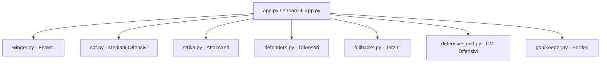

# FM Scout Gem

**FM Scout Gem** è un sistema avanzato di scouting per Football Manager che analizza i giocatori utilizzando statistiche avanzate e pesi differenziati per ruolo. Il sistema identifica i migliori talenti in base al loro valore (Value Index), considerando età, prezzo e performance.

## 🎯 Introduzione

Il progetto analizza i dati dei giocatori da file CSV, applicando modelli statistici specifici per ciascun ruolo calcistico. Ogni modulo è specializzato nel valutare le competenze richieste dal rispettivo archetipo tattico.

### Funzionalità Principali
- **7 Moduli Specializzati**: Winger, COF (Centrocampista Offensivo), Striker, Defensive Midfielder, Defender, Fullback, Goalkeeper
- **Value Index**: Metrica composita che bilancia performance, età e prezzo di mercato
- **Normalizzazione Min-Max**: Confronto equo tra giocatori nello stesso dataset
- **Fattore Età**: Premia i giovani talenti con moltiplicatori crescenti
- **Dimension Scores**: Analisi multidimensionale per stile di gioco
- **Gestione Errori Robusta**: Supporto per valori mancanti, formati valuta multipli e alias colonne

---

## 📊 Statistiche Analizzate per Ruolo

### 1. Goalkeeper (Portieri) - `goalkeeper.py`

#### Shot-Stopping (Peso Alto: 1.5-3.0x)
| Statistica | Peso | Descrizione | Rilevanza per il Ruolo | Impatto Decisioni |
|------------|------|-------------|------------------------|-------------------|
| **Save Percentage %** | **3.0x** | Percentuale di tiri respinti | Metrica primaria di efficienza parante; indica la capacità di respingere i tiri | Portieri con Save % > 75% sono prioritari per acquisti |
| **Clean Sheets %** | **2.5x** | Percentuale partite senza gol subiti | Capacità di mantenere la porta inviolata; fondamentale per il risultato squadra | Clean Sheets > 50% indica portiere solido |
| **Goals Conceded per 90** | **2.0x (invertito)** | Gol subiti per 90 minuti | Formula: `(10 - goals_conceded_p90) × 2.0` - meno gol subiti = punteggio più alto | Valore basso (< 1.0 gol/90) è ideale |
| **Saves per 90** | **1.5x** | Volume di parate | Indica impegno e reattività; portieri con molte parate sono sotto pressione | Utile per valutare portieri in squadre che subiscono molti tiri |

#### Distribution/Build-up (Peso Medio: 1.0-1.5x)
| Statistica | Peso | Descrizione | Rilevanza per il Ruolo | Impatto Decisioni |
|------------|------|-------------|------------------------|-------------------|
| **Pass Completion %** | **1.5x** | Precisione nei passaggi | Essenziale per portieri moderni che costruiscono dal basso | Portieri con Pass Completion > 85% sono preferiti |
| **Progressive Passes per 90** | **1.0x** | Passaggi progressivi | Capacità di avanzare palla con i passaggi; rompe le linee avversarie | Importante per sistemi con build-up dal fondo |
| **Distribution Accuracy %** | **1.0x** | Precisione distribuzione | Efficienza nella distribuzione del pallone ai difensori | Metrica secondaria ma utile per completezza |

#### Claiming/Defensive (Peso Basso: 0.5-1.0x)
| Statistica | Peso | Descrizione | Rilevanza per il Ruolo | Impatto Decisioni |
|------------|------|-------------|------------------------|-------------------|
| **Crosses Claimed %** | **0.6x** | Cross intercettati | Capacità di uscire sui cross; ridotto per bilanciamento | Utile ma non primario per portieri moderni |
| **High Claims per 90** | **0.8x** | Uscite alte | Uscite alte per dominare l'area; importante per portieri alti | Valore alto indica buona posizione e tempismo |
| **Sweeper Actions per 90** | **1.0x** | Interventi fuori porta | Interventi fuori area; aumentato per enfatizzare ruolo moderno | Cruciale per portieri sweepers in difesa alta |

#### Formula Score Portiere
```python
goalkeeper_score = (
    save_percentage × 3.0 +
    clean_sheets_pct × 2.5 +
    (10 - goals_conceded_p90) × 2.0 +
    saves_per_90 × 1.5 +
    pass_completion_pct × 1.5 +
    progressive_passes_p90 × 1.0 +
    distribution_accuracy_pct × 1.0 +
    crosses_claimed_pct × 0.6 +
    high_claims_p90 × 0.8 +
    sweeper_actions_p90 × 1.0
)
```

---

### 2. Defenders (Difensori) - `defenders.py`

#### Metriche Difensive (Peso Alto: 1.5-3.0x)
| Statistica | Peso | Descrizione | Rilevanza per il Ruolo | Impatto Decisioni |
|------------|------|-------------|------------------------|-------------------|
| **Defensive Actions per 90** | **3.0x** | Somma tackle + intercetti + clearances | Metrica difensiva primaria; somma tutte le azioni difensive | Difensori con > 10 azioni/90 sono eccellenti |
| **Tackles per 90** | **2.5x** | Tackle effettuati | Azione difensiva per eccellenza; capacità di recuperare possesso | Tackle > 3/90 indica aggressività difensiva |
| **Interceptions per 90** | **2.5x** | Intercetti effettuati | Leggibilità tattica e anticipazione; fondamentale per DM/CD | Interception > 2/90 è segnale di grande lettura |
| **Possession Won per 90** | **2.0x** | Recuperi possesso | Recupero possesso in zona difensiva; indica efficacia nel pressing | Utile per difensori che partecipano al pressing |
| **Clearances per 90** | **1.5x** | Allontanamenti palla | Allontanamento palla dall'area; utile ma secondario ai tackle | Clearances > 5/90 in difesa bassa è normale |
| **Blocks per 90** | **1.5x** | Blocchi tiri | Blocchi tiri avversari; azione difensiva importante | Blocks > 1/90 indica buona posizione |
| **Pressures Attempted per 90** | **1.5x** | Pressing effettuato | Intensità pressing; aumentato per enfatizzare ruolo moderno | Pressing alto è cruciale per difensori moderni |

#### Build-up Play (Peso Medio: 1.0-2.5x)
| Statistica | Peso | Descrizione | Rilevanza per il Ruolo | Impatto Decisioni |
|------------|------|-------------|------------------------|-------------------|
| **Progressive Passes per 90** | **2.5x** | Passaggi progressivi | Passaggi che avanzano la squadra; cruciale per difensori moderni | Progressive passes > 5/90 è ottimo |
| **Key Passes per 90** | **2.0x** | Passaggi decisivi | Passaggi decisivi che creano occasioni; importante per costruzione offensiva | Key passes > 1/90 indica creatività |
| **Creative Actions per 90** | **2.0x** | Azioni creative totali | Azioni creative totali; utile per difensori che partecipano all'attacco | Metrica secondaria ma utile |
| **Pass Completion %** | **1.5x** | Precisione passaggi | Precisione nei passaggi; base per build-up sicuro | Pass completion > 85% è requisito base |
| **Progressive Pass %** | **1.5x** | Percentuale progressivi | Percentuale passaggi progressivi; qualità della costruzione | Rapporto tra progressive e totali |
| **Passes Completed per 90** | **1.0x** | Volume passaggi | Volume passaggi completati; statistica di supporto | Utile come metrica secondaria |

#### Altre Metriche (Peso Basso: 0.5-2.0x)
| Statistica | Peso | Descrizione | Rilevanza per il Ruolo | Impatto Decisioni |
|------------|------|-------------|------------------------|-------------------|
| **Goal Contributions per 90** | **2.0x** | Gol + assist | Sorprendente alto ma utile per difensori offensivi | Difensori che segnano sono rari e preziosi |
| **Average Rating** | **1.5x** | Valutazione generale | Proxy di performance complessiva; utile come indicatore | Rating > 7.0 indica prestazione eccellente |
| **Header Win %** | **1.5x** | Duello aereo | Duello aereo; importante per difensori alti e fisici | Header win > 65% è solido |
| **Dribbles per 90** | **0.5x** | Dribbling | Peso basso perché non primario per difensori | Utile solo per difensori che avanzano con palla |

#### Formula Score Difensore
```python
defender_score = (
    defensive_actions_p90 × 3.0 +
    tackles_p90 × 2.5 +
    interceptions_p90 × 2.5 +
    possession_won_p90 × 2.0 +
    clearances_p90 × 1.5 +
    blocks_p90 × 1.5 +
    pressures_attempted_p90 × 1.5 +
    progressive_passes_p90 × 2.5 +
    key_passes_p90 × 2.0 +
    creative_actions_p90 × 2.0 +
    pass_completion_pct × 1.5 +
    progressive_pass_pct × 1.5 +
    passes_completed_p90 × 1.0 +
    goal_contributions_p90 × 2.0 +
    average_rating × 1.5 +
    header_win_pct × 1.5 +
    dribbles_p90 × 0.5
)
```

---

### 3. Fullbacks (Terzini) - `fullbacks.py`

#### Metriche Difensive (Peso Totale: ~8.7, 27%)
| Statistica | Peso | Descrizione | Rilevanza per il Ruolo | Impatto Decisioni |
|------------|------|-------------|------------------------|-------------------|
| **Defensive Actions per 90** | **2.8x** | Somma azioni difensive | Aumentato da 2.5 a 2.8 per enfatizzare azione difensiva | Terzini devono essere solidi difensivamente |
| **Possession Won per 90** | **2.2x** | Recuperi possesso | Aumentato da 2.0 a 2.2 per valorizzare recupero possesso | Recupero in zona terzina è cruciale |
| **Blocks per 90** | **1.8x** | Blocchi tiri | Blocchi tiri; utile ma non primario | Blocks > 1/90 è buono |
| **Pressures Attempted per 90** | **1.5x** | Pressing | Pressing; importante per terzini moderni | Pressing alto compensa mancanza di copertura |

#### Metriche Creative/Costruttive (Peso Totale: ~15.8, 49%)
| Statistica | Peso | Descrizione | Rilevanza per il Ruolo | Impatto Decisioni |
|------------|------|-------------|------------------------|-------------------|
| **xA per 90** | **2.5x** | Assist attesi | Cruciale per creazione occasioni; metrica avanzata | xA > 0.3/90 è eccellente per terzino |
| **Key Passes per 90** | **2.5x** | Passaggi decisivi | Ridotto da 3.0 a 2.5 per bilanciamento con difesa | Key passes > 1.5/90 è ottimo |
| **Progressive Passes per 90** | **2.0x** | Passaggi progressivi | Fondamentale per avanzamento palla lungo la fascia | Progressive passes > 4/90 è solido |
| **Progressive Pass %** | **2.5x** | Percentuale progressivi | Qualità costruzione; percentuale di passaggi che avanzano | Rapporto alto indica buona visione |
| **Open Play Cross Completion %** | **1.8x** | Cross efficaci | Precisione cross in gioco aperto; ruolo chiave terzino | Cross completion > 30% è buono |
| **Clear Cut Chances Created** | **2.0x** | Occasioni da gol create | Impatto offensivo diretto; statistiche avanzate | Metrica di impatto puro |
| **Crosses Completed** | **2.5x** | Cross efficaci | Statistica primaria per terzini; crossing è abilità chiave | Crosses > 3/90 è ottimo |

#### Metriche Offensive/Attaccanti (Peso Totale: ~6.5, 20%)
| Statistica | Peso | Descrizione | Rilevanza per il Ruolo | Impatto Decisioni |
|------------|------|-------------|------------------------|-------------------|
| **Dribbles per 90** | **1.5x** | Dribbling | Utile per terzini che avanzano con palla | Dribbling > 2/90 indica abilità |
| **Goal Contributions per 90** | **1.5x** | Gol + assist | Contributo offensivo occasionale; terzini segnano raramente | GC > 0.3/90 è raro ma prezioso |
| **xG per 90** | **1.0x** | Expected goals | Basso perché terzini non sono finalisti | xG basso è normale per ruolo |
| **xG Overperformance** | **0.5x** | Rumore statistico | Peso minimo; evita sovrastima | Metrica secondaria |
| **Header Win %** | **2.0x** | Duello aereo | Aumentato da 1.5 a 2.0 per enfatizzare gioco aereo | Header win > 60% è solido |

#### Metrica Negativa (Penalità: -2.0, 6%)
| Statistica | Peso | Descrizione | Rilevanza per il Ruolo | Impatto Decisioni |
|------------|------|-------------|------------------------|-------------------|
| **Mistakes Leading to Goals** | **-2.0x** | Errori che portano gol | Penalità alta appropriata; errori costano caro | Qualsiasi errore critico penalizza fortemente |

#### Formula Score Terzino
```python
fullback_score = (
    # Difesa
    defensive_actions_p90 × 2.8 +
    possession_won_p90 × 2.2 +
    blocks_p90 × 1.8 +
    pressures_attempted_p90 × 1.5 +
    
    # Creatività
    xa_p90 × 2.5 +
    key_passes_p90 × 2.5 +
    progressive_passes_p90 × 2.0 +
    progressive_pass_pct × 2.5 +
    open_play_cross_completion_pct × 1.8 +
    clear_cut_chances_created × 2.0 +
    crosses_completed × 2.5 +
    
    # Attacco
    dribbles_p90 × 1.5 +
    goal_contributions_p90 × 1.5 +
    xg_p90 × 1.0 +
    xg_overperformance × 0.5 +
    header_win_pct × 2.0 -
    
    # Penalità
    mistakes_leading_to_goals × 2.0
)
```

---

### 4. Defensive Mid (Centrocampisti Difensivi) - `defensive_mid.py`

#### Metriche Difensive Primarie (Peso Alto: 0.8-2.0x)
| Statistica | Peso | Descrizione | Rilevanza per il Ruolo | Impatto Decisioni |
|------------|------|-------------|------------------------|-------------------|
| **Tackles per 90** | **2.0x** | Tackle effettuati | Azione difensiva primaria; tackle è l'abilità chiave del DM | Tackles > 3/90 indica aggressività |
| **Interceptions per 90** | **1.8x** | Intercetti | Leggibilità tattica e anticipazione; fondamentale per DM puro | Interceptions > 2/90 è eccellente |
| **Pass Completion %** | **1.2x** | Precisione passaggi | Ridotto da 1.6 a 1.2 per bilanciamento difesa/costruzione | Pass completion > 85% è requisito base |
| **Progressive Passes per 90** | **1.0x** | Passaggi progressivi | Utile per DM moderni ma non primario | Progressive passes > 3/90 è buono |
| **Pressures Attempted per 90** | **1.0x** | Pressing | Ridotto da 1.3 a 1.0 per enfasi su difesa pura | Pressing alto è secondario alla difesa |
| **Possession Won per 90** | **0.9x** | Recuperi possesso | Utile ma meno specifico di tackle/intercetti | Metrica di supporto |
| **Header Win %** | **1.0x** | Duello aereo | Importante per DM fisici e alti | Header win > 60% è solido |

#### Metriche Moderato Impatto (Peso: 0.1-0.8x)
| Statistica | Peso | Descrizione | Rilevanza per il Ruolo | Impatto Decisioni |
|------------|------|-------------|------------------------|-------------------|
| **Average Rating** | **0.8x** | Valutazione generale | Ridotto da 0.9 a 0.8; proxy di performance complessiva | Rating > 7.0 è eccellente |
| **Key Passes per 90** | **0.2x** | Passaggi decisivi | Ridotto drasticamente da 0.7 a 0.2; statistica offensiva fuori ruolo | KP basso è normale per DM puro |
| **Shots Blocked per 90** | **0.5x** | Blocchi tiri | Aumentato da 0.4 a 0.5 per enfasi difensiva | Blocks > 0.5/90 è utile |
| **Goal Contributions per 90** | **0.1x** | Gol + assist | Ridotto da 0.3 a 0.1; DM segnano raramente | GC basso è normale |

#### Metrica Negativa (Penalità: -1.0x)
| Statistica | Peso | Descrizione | Rilevanza per il Ruolo | Impatto Decisioni |
|------------|------|-------------|------------------------|-------------------|
| **Mistakes Leading to Goals** | **-1.0x** | Errori che portano gol | Penalità aumentata da -0.7 a -1.0; errori critici costano | Qualsiasi errore è penalizzato fortemente |

#### Formula Score DM
```python
defensive_score = (
    tackles_p90 × 2.0 +
    interceptions_p90 × 1.8 +
    pass_completion_pct × 1.2 +
    progressive_passes_p90 × 1.0 +
    pressures_attempted_p90 × 1.0 +
    possession_won_p90 × 0.9 +
    header_win_pct × 1.0 +
    average_rating × 0.8 +
    key_passes_p90 × 0.2 +
    shots_blocked_p90 × 0.5 +
    goal_contributions_p90 × 0.1 -
    mistakes_leading_to_goals × 1.0
)
```

---

### 5. Winger (Esterni d'Attacco) - `winger.py`

#### Metriche Offensive (Peso Alto: 0.5-2.0x)
| Statistica | Peso | Descrizione | Rilevanza per il Ruolo | Impatto Decisioni |
|------------|------|-------------|------------------------|-------------------|
| **Goal Contributions per 90** | **2.0x** | Gol + assist | Peso massimo; somma gol+assist, predittività chiave | GC > 0.5/90 è eccellente per winger |
| **xG per 90** | **2.0x** | Expected goals | Qualità occasioni da gol; metrica avanzata fondamentale | xG > 0.3/90 è ottimo |
| **xA per 90** | **2.0x** | Expected assists | Creatività e creazione occasioni; metrica avanzata | xA > 0.2/90 è buono |
| **NP-xG per 90** | **1.5x** | xG senza rigori | Finalizzazione pura; esclude rigori dalla valutazione | NP-xG alto indica finalizzatore |
| **Dribbling completati per 90** | **1.6x** | Dribbling riusciti | Aumentato da 1.2 a 1.6; fondamentale per 1v1 | Dribbles > 3/90 è eccellente |
| **Shots on Target per 90** | **1.0x** | Tiri in porta | Precisione finalizzazione; tiri che colpiscono la porta | SoT > 2/90 è buono |
| **Key Passes per 90** | **1.5x** | Passaggi decisivi | Aumentato da 1.0 a 1.5; passaggi decisivi in terza finale | KP > 2/90 è ottimo |
| **Attacking Actions per 90** | **1.0x** | Azioni offensive totali | Somma di passaggi chiave, tiri e dribbling offensivi | Metrica composita utile |
| **Passaggi progressivi per 90** | **1.0x** | Passaggi progressivi | Progressione palla attraverso le linee difensive | Nuova metrica importante |
| **Cross riusciti per 90** | **1.8x** | Cross efficaci | Aumentato da 1.0 a 1.8; crossing è abilità primaria winger | Crosses > 3/90 è eccellente |
| **xG Overperformance** | **0.5x** | Rumore statistico | Ridotto da 2.0 a 0.5; evita rumore statistico e sovrastima | Metrica secondaria |

#### Metriche Difensive (Peso Basso: 0.1-0.4x)
| Statistica | Peso | Descrizione | Rilevanza per il Ruolo | Impatto Decisioni |
|------------|------|-------------|------------------------|-------------------|
| **Pressures Attempted per 90** | **0.4x** | Pressing | Peso basso perché winger offensivo; pressing secondario | Pressing alto è utile ma non primario |
| **Possession Won per 90** | **0.3x** | Recuperi possesso | Utile ma non primario per ruolo offensivo | Metrica di supporto |
| **Pressing Efficiency** | **0.2x** | Efficienza pressing | Nuova metrica; rapporto tra possession won e pressures | Metrica avanzata secondaria |
| **Header Win %** | **0.1x** | Duello aereo | Peso minimo per winger; duello aereo non primario | Header win basso è normale |

#### Formula Score Winger
```python
offensive_score = (
    goal_contributions_p90 × 2.0 +
    xg_p90 × 2.0 +
    xa_p90 × 2.0 +
    np_xg_p90 × 1.5 +
    dribbling_p90 × 1.6 +
    shots_targeted_p90 × 1.0 +
    key_passes_p90 × 1.5 +
    attacking_actions_p90 × 1.0 +
    passaggi_progressivi_p90 × 1.0 +
    cross_riusciti_p90 × 1.8 +
    xg_overperformance × 0.5 +
    
    # Difesa (pesi bassi)
    pressures_attempted_p90 × 0.4 +
    possession_won_p90 × 0.3 +
    pressing_efficiency × 0.2 +
    header_win_pct × 0.1
)
```

---

### 6. Strika (Attaccanti) - `strika.py`

#### Metriche Offensive Primarie (Peso Alto: 1.0-2.0x)
| Statistica | Peso | Descrizione | Rilevanza per il Ruolo | Impatto Decisioni |
|------------|------|-------------|------------------------|-------------------|
| **Goal Contributions per 90** | **2.0x** | Gol + assist | Peso massimo; gol+assist, predittività chiave | GC > 0.8/90 è eccellente per attaccante |
| **xG_Adjusted** | **2.0x** | xG bilanciato | Formula: `(NP-xG × 1.2) + (xG × 0.3)` poi × 2.0; finalizzazione bilanciata | Metrica composita avanzata |
| **Key Passes per 90** | **1.5x** | Passaggi decisivi | Creazione occasioni; attaccanti moderni devono creare | KP > 1.5/90 è buono |
| **xA per 90** | **1.5x** | Assist attesi | Creatività in area; assist attesi come metrica avanzata | xA > 0.2/90 è utile |
| **Shots on Target per 90** | **1.2x** | Tiri in porta | Precisione finalizzazione; tiri che colpiscono la porta | SoT > 3/90 è eccellente |
| **Shots per 90** | **1.0x** | Volume tiri | Aggressività offensiva; totale tiri effettuati | Shots > 4/90 indica aggressività |
| **Passaggi progressivi per 90** | **1.0x** | Passaggi progressivi | Nuova metrica; progressione offensiva con passaggi | Metrica secondaria |

#### Metriche Secondarie (Peso Medio: 0.5-0.8x)
| Statistica | Peso | Descrizione | Rilevanza per il Ruolo | Impatto Decisioni |
|------------|------|-------------|------------------------|-------------------|
| **Pressures Attempted per 90** | **0.8x** | Pressing | Attaccanti moderni devono pressare; pressing alto | Pressing > 5/90 è buono |
| **Possession Won per 90** | **0.8x** | Recuperi possesso | Nuova metrica; recupero possesso in attacco | Metrica avanzata utile |
| **Pass Completion %** | **0.5x** | Precisione passaggi | Utile ma non primario per attaccante | Pass completion > 75% è base |
| **xG Overperformance** | **0.5x** | Rumore statistico | Peso ridotto; evita sovrastima delle prestazioni | Metrica secondaria |

#### Formula Score Attaccante
```python
striker_score = (
    goal_contributions_p90 × 2.0 +
    
    # xG_Adjusted formula speciale
    ((np_xg_p90 × 1.2) + (xg_p90 × 0.3)) × 2.0 +
    
    key_passes_p90 × 1.5 +
    xa_p90 × 1.5 +
    shots_on_target_p90 × 1.2 +
    shots_p90 × 1.0 +
    pressures_p90 × 0.8 +
    pass_completion_pct × 0.5 +
    passaggi_progressivi_p90 × 1.0 +
    possession_won_p90 × 0.8 +
    xg_overperformance × 0.5
)
```

---

### 7. COF (Mediani Offensivi Creativi) - `cof.py`

#### Metriche Creative/Playmaking (Peso Alto: 1.5-2.0x)
| Statistica | Peso | Descrizione | Rilevanza per il Ruolo | Impatto Decisioni |
|------------|------|-------------|------------------------|-------------------|
| **xA per 90** | **2.0x** | Assist attesi | Metrica creativa primaria; assist attesi come indicatore di creatività | xA > 0.3/90 è eccellente |
| **Key Passes per 90** | **1.8x** | Passaggi decisivi | Creatività in terza finale; passaggi che creano occasioni | KP > 2.5/90 è ottimo |
| **Goal Contributions per 90** | **2.0x** | Gol + assist | Impatto offensivo totale; metrica composita | GC > 0.6/90 è eccellente |
| **Passaggi progressivi per 90** | **1.6x** | Passaggi progressivi | Aumentato da 1.3 a 1.6; progressione palla attraverso le linee | Progressive passes > 4/90 è buono |

#### Metriche Finitura (Peso Medio-Alto: 1.0-1.8x)
| Statistica | Peso | Descrizione | Rilevanza per il Ruolo | Impatto Decisioni |
|------------|------|-------------|------------------------|-------------------|
| **xG per 90** | **1.8x** | Expected goals | Qualità occasioni da gol; metrica avanzata fondamentale | xG > 0.4/90 è ottimo |
| **NP-xG per 90** | **1.2x** | xG senza rigori | Ridotto da 1.7 a 1.2; finalizzazione pura bilanciata | NP-xG alto indica finalizzatore |
| **Shots on Target per 90** | **1.0x** | Tiri in porta | Precisione; tiri che colpiscono la porta | SoT > 2.5/90 è buono |
| **Dribbling completati per 90** | **1.4x** | Dribbling riusciti | Aumentato da 1.0 a 1.4; capacità di superare avversari | Dribbles > 2.5/90 è eccellente |
| **xG Overperformance** | **0.5x** | Rumore statistico | Solo se > 0; rumore statistico ridotto | Metrica secondaria condizionale |

#### Metriche Difensive/Pressing (Peso Basso: 0.2-0.4x)
| Statistica | Peso | Descrizione | Rilevanza per il Ruolo | Impatto Decisioni |
|------------|------|-------------|------------------------|-------------------|
| **Pressures Attempted per 90** | **0.4x** | Pressing | Peso basso perché COF offensivo; pressing secondario | Pressing alto è utile ma non primario |
| **Possession Won per 90** | **0.3x** | Recuperi possesso | Utile ma non primario per ruolo creativo | Metrica di supporto |
| **Header Win %** | **0.1x** | Duello aereo | Peso minimo; duello aereo non primario per COF | Header win basso è normale |

#### Formula Score COFF
```python
cof_score = (
    # Creative metrics (pesi elevati)
    xa_p90 × 2.0 +
    key_passes_p90 × 1.8 +
    goal_contributions_p90 × 2.0 +
    passaggi_progressivi_p90 × 1.6 +
    
    # Finishing metrics (pesi moderati-elevati)
    xg_p90 × 1.8 +
    np_xg_p90 × 1.2 +
    shots_targeted_p90 × 1.0 +
    dribbling_p90 × 1.4 +
    xg_overperformance × 0.5 +
    
    # Defensive/pressing metrics (pesi bassi)
    pressures_attempted_p90 × 0.4 +
    possession_won_p90 × 0.3 +
    header_win_pct × 0.1
)
```

---

## ⚖️ Pesi Assegnati a Ogni Variabile

### Tabella Comparativa Pesi per Ruolo

| Metrica | GK | DEF | FB | DM | Winger | Striker | COF |
|---------|----|-----|----|----|--------|---------|------|
| **Goal Contributions/90** | - | 2.0 | 1.5 | 0.1 | 2.0 | 2.0 | 2.0 |
| **xG/90** | - | - | 1.0 | - | 2.0 | 0.6* | 1.8 |
| **xA/90** | - | - | 2.5 | - | 2.0 | 1.5 | 2.0 |
| **Tackles/90** | - | 2.5 | - | 2.0 | - | - | - |
| **Interceptions/90** | - | 2.5 | - | 1.8 | - | - | - |
| **Defensive Actions/90** | - | 3.0 | 2.8 | - | - | - | - |
| **Key Passes/90** | - | 2.0 | 2.5 | 0.2 | 1.5 | 1.5 | 1.8 |
| **Progressive Passes/90** | 1.0 | 2.5 | 2.0 | 1.0 | 1.0 | 1.0 | 1.6 |
| **Pass Completion %** | 1.5 | 1.5 | - | 1.2 | - | 0.5 | - |
| **Save Percentage %** | 3.0 | - | - | - | - | - | - |
| **Clean Sheets %** | 2.5 | - | - | - | - | - | - |
| **Goals Conceded/90** | 2.0 (inv) | - | - | - | - | - | - |
| **Saves/90** | 1.5 | - | - | - | - | - | - |
| **Mistakes Leading to Goals** | - | - | -2.0 | -1.0 | - | - | - |
| **Pressures Attempted/90** | - | 1.5 | 1.5 | 1.0 | 0.4 | 0.8 | 0.4 |
| **Possession Won/90** | - | 2.0 | 2.2 | 0.9 | 0.3 | 0.8 | 0.3 |
| **Header Win %** | - | 1.5 | 2.0 | 1.0 | 0.1 | - | 0.1 |
| **Dribbles/90** | - | 0.5 | 1.5 | - | 1.6 | - | 1.4 |
| **Shots on Target/90** | - | - | - | - | 1.0 | 1.2 | 1.0 |
| **Crosses Completed** | - | - | 2.5 | - | 1.8 | - | - |

*Nota: xG_Adjusted = (NP-xG × 1.2) + (xG × 0.3), poi moltiplicato per 2.0

---

## 🏗️ Architettura del Sistema



### Componenti Comuni a Tutti i Moduli

| Funzione | Scopo | Formula/Valori |
|----------|-------|----------------|
| `parse_guide_value()` | Parsing valore guida | €K → ×1000, €M → ×1.000.000 |
| `calculate_age_factor()` | Fattore età | ≤20: 2.0x, 21-23: 1.6x, 24-26: 1.3x, >26: 1.0x |
| `min_max_normalize()` | Normalizzazione | `(val - min) / (max - min)` → [0, 1] |
| `scale_value_index_to_100()` | Scaling punteggio | `(val - min) / (max - min) × 100` |
| `calculate_value_index()` | Indice valore | `(score × age_factor) / price` |

### Flusso di Elaborazione Completo


### Formula Value Index (comune a tutti i moduli)
```python
Value Index = (Role Score × Age Factor) / Guide Value
```

---

## 📦 Installazione e Utilizzo

### Requisiti di Sistema
- Python 3.8+
- pandas, numpy (gestione dati)
- streamlit (interfaccia web opzionale)

### Installazione

```bash
# Clona il repository
git clone https://github.com/yourusername/fm-scout-gem.git
cd fm-scout-gem

# Installa le dipendenze
pip install -r requirements.txt
```

### Utilizzo Base

```python
from app import process_analysis

# Carica i dati da CSV
df = pd.read_csv('players.csv')

# Esegui analisi per un ruolo specifico
result_html, debug_html = process_analysis(df, mode='winger', cm=15000000)

# Salva risultati
with open('output.html', 'w') as f:
    f.write(result_html)
```

### Interfaccia Web (Streamlit)

```bash
streamlit run streamlit_app.py
```

### Struttura File
```
fm-scout-gem/
├── app.py                    # Applicazione principale
├── streamlit_app.py          # Interfaccia web Streamlit
├── winger.py                 # Modulo esterni d'attacco
├── cof.py                    # Modulo mediani offensivi
├── strika.py                 # Modulo attaccanti
├── defenders.py              # Modulo difensori
├── fullbacks.py              # Modulo terzini
├── defensive_mid.py          # Modulo cm difensivi
├── goalkeeper.py             # Modulo portieri
├── sample_players.csv        # Dataset di esempio
└── requirements.txt          # Dipendenze
```

### Filtri Disponibili
| Filtro | Condizione | Default |
|--------|------------|---------|
| **Prezzo Minimo** | Guide Value ≥ min_price | €0 |
| **Prezzo Massimo** | Guide Value ≤ price_threshold | €15M (default UI) |
| **Presenze Minime** | Appearances ≥ min_apps | 10 |
| **Età Massima** | Age < max_age | 30 anni |

---

## 📈 Note Tecniche

### Gestione Errori
- Valori NaN gestiti con fallback a 0 o NaN
- Parsing errori su Guide Value generano warning e valore NaN
- Try/except per operazioni matematiche su valori non numerici

### Alias Colonne Supportati
| Colonna | Alias Riconosciuti |
|---------|-------------------|
| Name | name, player, fullname, full_name, title |
| Club | club, team, organization, company |
| Age | age, years, duration |
| Guide Value | value, price, guide_value, guide value, cost, worth |
| Appearances | appearances, apps, games_played, playtime |

### Formati Valuta Supportati
- `€1.2M` → 1,200,000
- `€50K` → 50,000
- `€1200000` → 1,200,000 (formato diretto)

---

## 🔍 Anomalie e Discrepanze Rilevate

### 🔴 Anomalie Critiche
| # | Problema | Modulo | Impatto |
|---|----------|--------|---------|
| 1 | **Age Factor diverso** | fullbacks.py | Formula diversa: ≤23: 1.2, 24-27: 1.0, 28-30: 0.8, >30: 0.6 (altri moduli: ≤20: 2.0, 21-23: 1.6, 24-26: 1.3, >26: 1.0) |
| 2 | **Normalizzazione diversa** | fullbacks.min_max_normalize() | Restituisce [0.5] quando min==max (altri moduli restituiscono [0.0]) |
| 3 | **Naming errato** | fullbacks.calculate_value_index() | Cerca "Defender Score" prima di "Fullback Score" |

### 🟡 Anomalie Moderate
| # | Problema | Modulo | Impatto |
|---|----------|--------|---------|
| 4 | **Incoerenza pesi xG** | winger.py | calculate_offensive_score usa 2.0x, compute_dimension_scores usa 1.5x per dimensione finalizzazione |
| 5 | **Incoerenza pesi Key Passes** | winger.py | calculate_offensive_score usa 1.5x, compute_dimension_scores usa 1.5x (ora uniforme dopo aggiornamento) |
| 6 | **Peso xG Overperformance variabile** | winger/cof/defensive_mid | winger: 0.5x sempre, cof: 0.5x solo se >0, defensive_mid: 0.4x solo se >0 |

### 🟢 Anomalie Minori
| # | Problema | Modulo | Impatto |
|---|----------|--------|---------|
| 7 | **Funzione legacy run_scout_analysis** | app.py | Usa normalize() da scout_app invece di min_max_normalize(); calcola score come media ponderata invece di somma semplice |
| 8 | **Metriche mancanti in alcuni moduli** | vari | Mistakes Leading to Goals solo in DM e FB; Creative Actions solo in DEF; Save Percentage solo in GK |

---

## 📚 Riferimenti

- [ANALISI_STATISTICHE_PESI.md](ANALISI_STATISTICHE_PESI.md) - Analisi completa dei pesi
- [REPORT_STATISTICHE.md](REPORT_STATISTICHE.md) - Report esaustivo statistiche
- [plans/](plans/) - Documentazione dettagliata per ruolo

---

*FM Scout Gem - Sistema avanzato di scouting per Football Manager*
