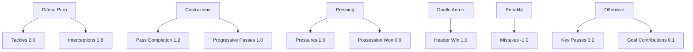

# Analisi Sistematica dei Pesi Statistici - Defensive Midfielder (DM)

## 1. Riepilogo dei Pesi Attuali nel Codice

### Funzione `calculate_defensive_score()` (righe 82-166)

| Metrica | Peso Assegnato | Categoria |
|---------|---------------|-----------|
| Tackles per 90 | **2.0** | HIGH IMPACT |
| Interceptions per 90 | **1.6** | HIGH IMPACT |
| Pass Completion % | **1.6** | HIGH IMPACT |
| Progressive Passes per 90 | **1.3** | HIGH IMPACT |
| Pressures Attempted per 90 | **1.3** | HIGH IMPACT |
| Possession Won per 90 | **1.1** | HIGH IMPACT |
| Header Win % | **1.1** | HIGH IMPACT |
| Average Rating | **0.9** | MODERATE |
| Key Passes per 90 | **0.7** | MODERATE |
| Shots Blocked per 90 | **0.4** | MODERATE |
| xG Overperformance | **0.4** | MODERATE |
| Goal Contributions per 90 | **0.3** | MODERATE |
| Mistakes Leading to Goals | **-0.7** | NEGATIVO |

### Funzione `compute_dimension_scores()` (righe 497-669)

| Dimensione | Metriche | Pesi Originali | Note |
|------------|----------|----------------|------|
| difesa | Tackles per 90, Interceptions per 90 | 2.0, 1.6 | Normalizzati automaticamente |
| possesso | Pass Completion %, Progressive Passes per 90 | 1.6, 1.3 | Normalizzati automaticamente |
| pressing | Pressures Attempted per 90, Possession Won per 90 | 1.3, 1.1 | Normalizzati automaticamente |
| difesa_aerea | Header Win % | 1.1 | Default 50 se mancante |
| attacco | Average Rating, Key Passes per 90 | Dinamico | Media delle altre 4 dimensioni + bonus |

---

## 2. Confronto con le Best Practice FM per DM

### Ruolo del DM in Football Manager:
Un centrocampista difensivo ideale deve eccellere in:
1. **Difesa pura** (tackles, intercetti, duel win rate)
2. **Posizione e lettura del gioco** (intercetti, possession won)
3. **Passaggio corto e costruzione** (pass completion, progressive passes)
4. **Pressing e recupero palla** (pressures, ball recovery)
5. **Duello aereo** (header win %) se fisico

### Analisi dei Pesi:

#### ✅ CORRETTI - Metriche Difensive Primarie
| Metrica | Peso | Valutazione |
|---------|------|-------------|
| Tackles per 90 | 2.0 | **Corretto** - Il tackle è l'azione difensiva per eccellenza del DM |
| Interceptions per 90 | 1.6 | **Corretto** - Leggibilità tattica fondamentale per un DM |
| Possession Won per 90 | 1.1 | **Accettabile** - Utile ma meno specifico di tackles/intercetti |

#### ⚠️ DISCUSSIBILI - Metriche Ibride
| Metrica | Peso | Problema |
|---------|------|----------|
| Pass Completion % | 1.6 | **Sovrappeso** - Un DM deve passare ma non è il suo ruolo primario; un CD/DM moderno passa bene ma la priorità resta la difesa |
| Progressive Passes per 90 | 1.3 | **Leggermente alto** - Utile per DM moderni (Rodri, Kanté) ma non dovrebbe superare i pesi difensivi puri |

#### ❌ PROBLEMATICI - Metriche Fuori Ruolo
| Metrica | Peso | Problema |
|---------|------|----------|
| Key Passes per 90 | 0.7 | **Troppo alto** - I key pass sono statistiche da centrocampista offensivo (AM/CM avanzato), non da DM puro |
| xG Overperformance | 0.4 | **Fuori contesto** - Un DM segna raramente; questa metrica è irrilevante per il ruolo |
| Goal Contributions per 90 | 0.3 | **Basso ma accettabile** - I DM possono contribuire ma non sono il focus |

#### ⚠️ DA VALUTARE
| Metrica | Peso | Note |
|---------|------|------|
| Average Rating | 0.9 | Utile come proxy generale, ma può essere manipolato da statistiche offensive |
| Shots Blocked per 90 | 0.4 | **Basso ma corretto** - I DM bloccano tiri ma non sono i principali responsabili |
| Mistakes Leading to Goals | -0.7 | **Corretto** - Penalità appropriata per errori difensivi critici |

---

## 3. Problemi Identificati

### PROBLEMA 1: Squilibrio Difesa vs Costruzione
- **Pass Completion % (1.6)** ha lo stesso peso di **Interceptions (1.6)**
- In FM, un DM puro dovrebbe avere pesi difensivi nettamente superiori a quelli costruttivi
- **Raccomandazione**: Pass Completion % → 1.2, Interceptions → 1.8

### PROBLEMA 2: Key Passes troppo ponderato
- **Key Passes per 90 (0.7)** è una statistica da centrocampista offensivo
- Un DM puro dovrebbe avere KP molto basso o nullo nel punteggio
- **Raccomandazione**: Key Passes → 0.3 o rimuoverlo dal calcolo difensivo

### PROBLEMA 3: xG Overperformance irrilevante
- I DM segnano pochissimo; xG overperformance è rumore statistico per questo ruolo
- **Raccomandazione**: Rimuovere completamente o abbassare a 0.1

### PROBLEMA 4: Dimensione "attacco" mal definita
- La funzione `compute_dimension_scores()` include Average Rating e Key Passes nell'attacco
- Questo crea un bias verso giocatori che fanno più passaggi chiave che difesa
- **Raccomandazione**: Ricalibrare attacco_score come media delle altre 4 dimensioni senza bonus offensivi

### PROBLEMA 5: Pressing vs Difesa pura
- **Pressures Attempted (1.3)** e **Possession Won (1.1)** sono vicini tra loro
- In FM, il pressing è importante ma secondario rispetto a tackles/intercetti
- **Raccomandazione**: Pressures → 1.0, Possession Won → 0.9

---

## 4. Pesi Raccomandati per DM (Best Practice FM)

| Metrica | Peso Attuale | Peso Raccomandato | Motivazione |
|---------|-------------|------------------|-------------|
| Tackles per 90 | 2.0 | **2.0** | Mantenere - azione difensiva primaria |
| Interceptions per 90 | 1.6 | **1.8** | Aumentare - leggibilità tattica fondamentale |
| Pass Completion % | 1.6 | **1.2** | Ridurre - importante ma secondario alla difesa |
| Progressive Passes per 90 | 1.3 | **1.0** | Ridurre - utile per DM moderni ma non primario |
| Pressures Attempted per 90 | 1.3 | **1.0** | Ridurre leggermente - pressing secondario |
| Possession Won per 90 | 1.1 | **0.9** | Ridurre - utile ma meno specifico |
| Header Win % | 1.1 | **1.0** | Mantenere simile - duello aereo importante |
| Average Rating | 0.9 | **0.8** | Leggero abbassamento - proxy generico |
| Key Passes per 90 | 0.7 | **0.2** | Ridurre drasticamente - statistica offensiva |
| Shots Blocked per 90 | 0.4 | **0.5** | Aumentare leggermente - azione difensiva valida |
| xG Overperformance | 0.4 | **0.0** | Rimuovere - irrilevante per DM |
| Goal Contributions per 90 | 0.3 | **0.1** | Abbassare - contributo occasionale |
| Mistakes Leading to Goals | -0.7 | **-1.0** | Aumentare penalità - errori critici |

---

## 5. Diagramma di Bilanciamento Raccomandato

---

## 6. Conclusioni

### Punti di Forza del Codice Attuale:
- ✅ Struttura modulare chiara con funzioni separate
- ✅ Penalità per errori difensivi ben implementata
- ✅ Normalizzazione automatica dei pesi nelle dimensioni
- ✅ Gestione robusta dei valori NaN

### Aree di Miglioramento:
- ⚠️ **Squilibrio difesa/costruzione** - Pass Completion troppo alto rispetto a Interceptions
- ⚠️ **Metriche offensive fuori ruolo** - Key Passes e xG Overperformance andrebbero ridotte/rimosse
- ⚠️ **Dimensione attacco mal calibrata** - Dovrebbe essere puramente difensiva per un DM puro

### Priorità di Intervento:
1. **ALTA**: Ridurre Key Passes da 0.7 a 0.2
2. **ALTA**: Aumentare Interceptions da 1.6 a 1.8
3. **MEDIA**: Ridurre Pass Completion da 1.6 a 1.2
4. **MEDIA**: Rimuovere xG Overperformance dal calcolo
5. **BASSA**: Ricalibrare la dimensione attacco_score
