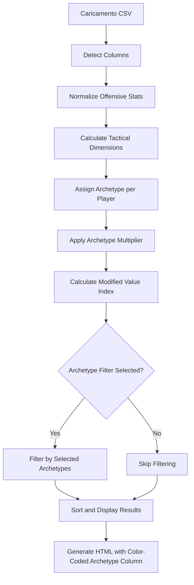

# Piano di Integrazione Archeotipi - FM Scout Gem

## Riepilogo Decisioni

### Mapping Dimensioni Tattiche (Confermato)
| Dimensione | Metriche Utilizzate | Formula |
|------------|---------------------|---------|
| **Attacco** | xG per 90, NP-xG per 90, Shots on Target per 90 | Media ponderata normalizzazioni |
| **Pressing** | Attacking Actions per 90, Key Passes per 90 | Media normalizzazioni |
| **Difesa Aerea** | xG Overperformance (proxy) | Valore normalizzato |
| **Creazione** | xA per 90, Key Passes per 90 | Media ponderata normalizzazioni |
| **Finalizzazione** | Shots per 90, NP-xG per 90 | Media normalizzazioni |

### Moltiplicatori Value Index (Confermati)
```python
ARCHETYPE_MULTIPLIERS = {
    'Two-Way': 1.2,
    'Segna & Pressa': 1.2,
    'Crea & Pressa': 1.2,
    'Da Sviluppare': 0.8,
    # Default: 1.0 per tutti gli altri archeotipi
}
```

### UI (Confermata)
- **Checkbox multiselect** per selezione multipla archeotipi
- Default: nessun filtro (mostra tutti i giocatori)
- Filtro applicato post-analisi

---

## Architettura Dettagliata

### 1. Nuova Funzione: `calculate_tactical_dimensions()`

```python
def calculate_tactical_dimensions(df, available_off):
    """
    Calcola le 5 dimensioni tattiche dalle statistiche offensive normalizzate.
    
    Args:
        df: DataFrame con colonne statistiche offensive
        available_off: dict con mapping standard_name -> actual_column
        
    Returns:
        DataFrame con colonne aggiuntive: _attacco, _pressing, _difesa_aerea, 
        _creazione, _finalizzazione (valori 0-100)
    """
    # Mappa delle dimensioni alle colonne offensive
    dimension_mappings = {
        'attacco': ['xG per 90', 'NP-xG per 90', 'Shots on Target per 90'],
        'pressing': ['Attacking Actions per 90', 'Key Passes per 90'],
        'difesa_aerea': ['xG Overperformance'],
        'creazione': ['xA per 90', 'Key Passes per 90'],
        'finalizzazione': ['Shots per 90', 'NP-xG per 90']
    }
    
    for dimension, columns in dimension_mappings.items():
        # Trova le colonne disponibili
        available_cols = []
        for col_name in columns:
            if col_name in available_off:
                norm_col = f'_norm_{available_off[col_name]}'
                if norm_col in df.columns:
                    available_cols.append(norm_col)
        
        # Calcola la media delle normalizzazioni disponibili
        if available_cols:
            df[f'_{dimension}'] = df[available_cols].mean(axis=1) * 100
        else:
            # Se nessuna colonna disponibile, imposta a 0
            df[f'_{dimension}'] = 0
    
    return df
```

### 2. Integrazione in `analyze_csv()`

**Modifiche da apportare:**

```python
# Dopo il calcolo di Offensive Score (linea 251):

# Calcola dimensioni tattiche
filtered_df = calculate_tactical_dimensions(filtered_df, available_off)

# Assegna archetipo a ogni giocatore
filtered_df['Archetype'] = filtered_df.apply(
    lambda row: assign_archetype(row), axis=1
)

# Applica moltiplicatore archetipo al Value Index
ARCHETYPE_MULTIPLIERS = {
    'Two-Way': 1.2,
    'Segna & Pressa': 1.2,
    'Crea & Pressa': 1.2,
    'Da Sviluppare': 0.8,
}

def get_archetype_multiplier(archetype: str) -> float:
    return ARCHETYPE_MULTIPLIERS.get(archetype, 1.0)

filtered_df['Archetype Multiplier'] = filtered_df['Archetype'].apply(get_archetype_multiplier)

# Ricalcola Value Index con moltiplicatore archetipo
filtered_df['Value Index'] = (
    filtered_df['Offensive Score'] * 
    filtered_df['Age Factor'] * 
    filtered_df['Archetype Multiplier']
) / filtered_df['_price']
```

### 3. Colonna Archetype nell'Output

**Modifiche al DataFrame di output:**

```python
# Aggiungere colonna Archetype nel result_out (dopo linea 292):
result_out['Archetype'] = sorted_df['Archetype']

# Mappa colori per archetipo
ARCHETYPE_COLORS = {
    'Two-Way': '#2ea8a8',      # Cyan - difensore completo
    'Segna & Pressa': '#3fb85b', # Verde - pressing intenso
    'Crea & Pressa': '#58a6ff',  # Blu - creativo con pressing
    'Segna & Crea': '#d291ff',   # Viola - offensivo completo
    'Finalizzatore': '#f55a3c',  # Rosso - bomber puro
    'Creatore': '#dbca8a',       # Oro - playmaker
    'Pressatore': '#e36e4a',     # Arancione - pressing specialist
    'Offensivo': '#f7d759',      # Giallo - attaccante
    'Bilanciato': '#8b94dc',     # Lavanda - versatile
    'Da Sviluppare': '#6e7681'   # Grigio - da migliorare
}
```

**Styling CSS condizionale:**

```css
.archetype-Two-Way { background-color: #2ea8a8; color: white; }
.archetype-Segna-Pressa { background-color: #3fb85b; color: white; }
/* ... altri stili ... */
```

### 4. UI Gradio - Filtri Archeotipi (app.py)

**Nuovo componente:**

```python
ARCHETYPE_OPTIONS = [
    "Two-Way", "Segna & Pressa", "Crea & Pressa", 
    "Segna & Crea", "Finalizzatore", "Creatore", 
    "Pressatore", "Offensivo", "Bilanciato", "Da Sviluppare"
]

archetype_filter = gr.CheckboxGroup(
    choices=ARCHETYPE_OPTIONS,
    value=[],  # Default: nessun filtro
    label="🎯 Filtra per Archetipo (lascia vuoto per vedere tutti)"
)
```

**Modifica funzione `run_scout_analysis()`:**

```python
def run_scout_analysis(file, min_price, price_threshold, min_apps, max_age, selected_archetypes=None):
    csv_path = file.name if file is not None else DEFAULT_CSV
    min_price_val = int(float(min_price) * 1_000_000)
    price_val = float(price_threshold) * 1_000_000
    result = analyze_csv(csv_path, price_val, min_price_val, int(min_apps), int(max_age))
    
    # Se archeotipi selezionati, applica filtro post-analisi
    if selected_archetypes and len(selected_archetypes) > 0:
        # Estrai i giocatori dal risultato e filtra per archetipo
        # (implementazione da definire in base alla struttura HTML)
        pass
    
    return result
```

**Aggiunta UI nel layout:**

```python
with gr.Row():
    with gr.Column(scale=1, elem_classes="dark-mode"):
        # ... componenti esistenti ...
        
        archetype_filter = gr.CheckboxGroup(
            choices=ARCHETYPE_OPTIONS,
            value=[],
            label="🎯 Filtra per Archetipo"
        )
        
        submit_btn = gr.Button("🔍 Analizza Giocatori", variant="primary")
    
    with gr.Column(scale=2, elem_classes="dark-mode"):
        output_html = gr.HTML(label="📊 Analysis Results")

# Modifica click handler per includere archetype_filter
submit_btn.click(
    fn=run_scout_analysis,
    inputs=[file_input, min_price_slider, price_slider, apps_slider, age_slider, archetype_filter],
    outputs=output_html
)
```

### 5. Backward Compatibility

**Gestione dati senza colonne tattiche:**
- Se le statistiche offensive non sono sufficienti per calcolare le dimensioni, assegna "Da Sviluppare"
- Il moltiplicatore default è 1.0 (nessun effetto sul Value Index)
- I test esistenti devono continuare a passare

---

## Struttura del Flusso Dati Modificato



---

## Modifiche ai File

### scout_app.py
1. ✅ Aggiungere funzione `calculate_tactical_dimensions()`
2. ✅ Integrare calcolo dimensioni in `analyze_csv()` dopo Offensive Score
3. ✅ Aggiungere moltiplicatore archetipo al Value Index
4. ✅ Aggiungere colonna Archetype all'output DataFrame
5. ✅ Mantenere backward compatibility

### app.py
1. ✅ Aggiungere CheckboxGroup per filtri archeotipi
2. ✅ Modificare `run_scout_analysis()` per accettare parametro `selected_archetypes`
3. ✅ Applicare filtro post-analisi se archeotipi selezionati
4. ✅ Aggiornare click handler per includere nuovo input

### test_scout_app.py
1. ✅ Aggiungere test per `calculate_tactical_dimensions()`
2. ✅ Aggiungere test per moltiplicatore archetipo
3. ✅ Aggiungere test integrazione end-to-end con Value Index modificato

### sample_players.csv (opzionale)
- Mantenere struttura attuale (le dimensioni saranno calcolate automaticamente)
- Eventualmente aggiungere colonne tattiche esplicite per testing avanzato

---

## Test da Aggiungere

### Test Unitari:
```python
def test_calculate_tactical_dimensions():
    """Test calcolo dimensioni tattiche"""
    # Creare DataFrame di test con statistiche offensive
    # Verificare che le 5 dimensioni siano calcolate correttamente
    
def test_archetype_multiplier():
    """Test moltiplicatori archetipo"""
    # Verificare moltiplicatori corretti per ogni archeotipo
    
def test_value_index_with_archetype():
    """Test Value Index con moltiplicatore archetipo"""
    # Verificare che Value Index includa il moltiplicatore
```

### Test End-to-End:
```python
def test_full_analysis_with_archetypes():
    """Test analisi completa con integrazione archeotipi"""
    # Test flusso completo da CSV a HTML con archeotipi
    
def test_archetype_filtering():
    """Test filtro UI per archeotipi"""
    # Verificare che il filtro multiselect funzioni correttamente
```

---

## Priorità di Implementazione

1. **Alta**: Integrazione calcolo dimensioni in scout_app.py
2. **Alta**: Moltiplicatore Value Index basato su archetipo
3. **Media**: UI multiselect in app.py
4. **Media**: Color-coding colonna Archetype nella tabella HTML
5. **Bassa**: Test aggiuntivi e validazione completa

---

## Note Tecniche

### Gestione Errori:
- Se le statistiche offensive sono insufficienti (< 3 colonne), mantenere comportamento attuale
- Se il calcolo delle dimensioni fallisce, assegnare "Da Sviluppare" come default
- Log di debug per tracciare il flusso di calcolo

### Performance:
- Il calcolo delle dimensioni avviene una sola volta per analisi
- L'assegnazione archetipo usa apply() su DataFrame (efficiente per dataset piccoli)
- Il filtro archeotipo è applicato post-analisi (non influisce sulle performance di calcolo)

### Testing:
- Eseguire test esistenti prima e dopo le modifiche
- Aggiungere nuovi test per le funzionalità integrate
- Verificare backward compatibility con dati senza colonne tattiche
